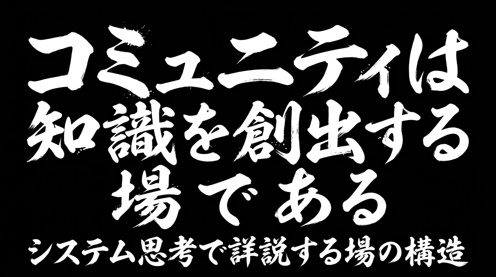
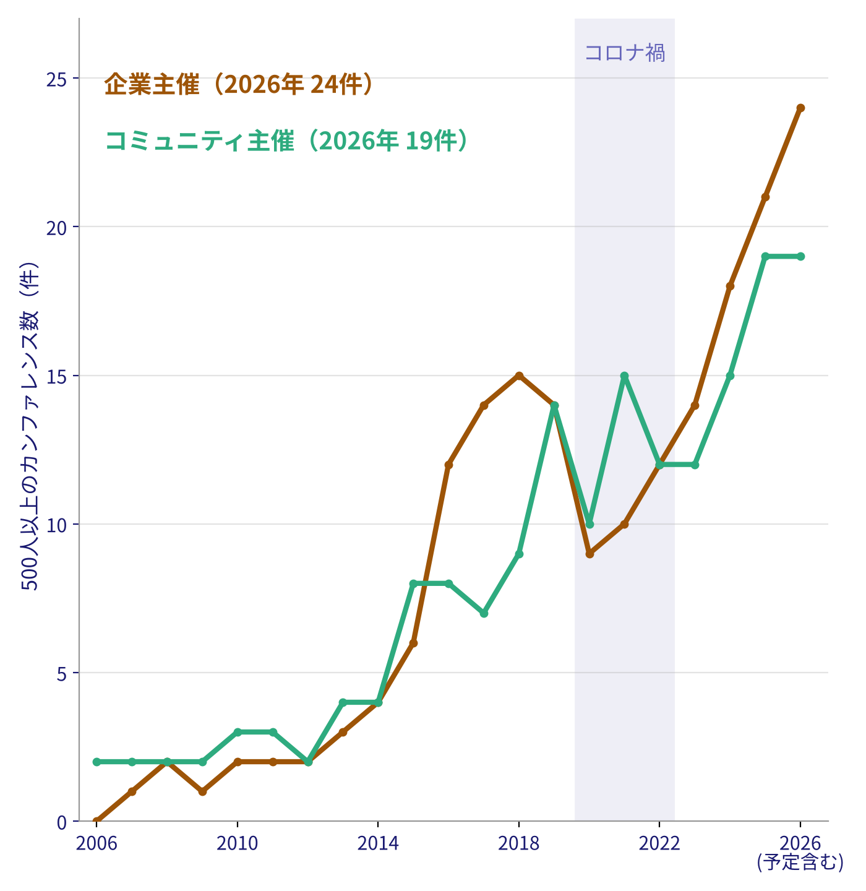
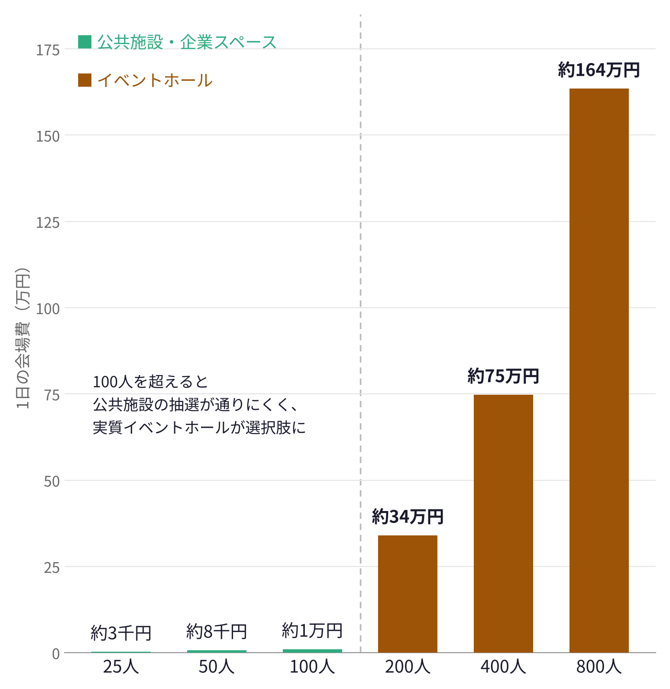
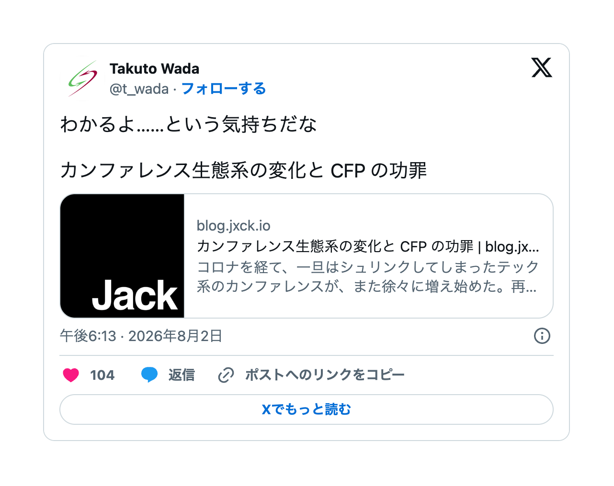
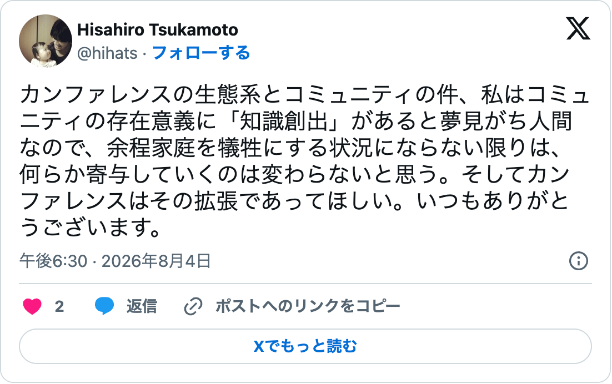
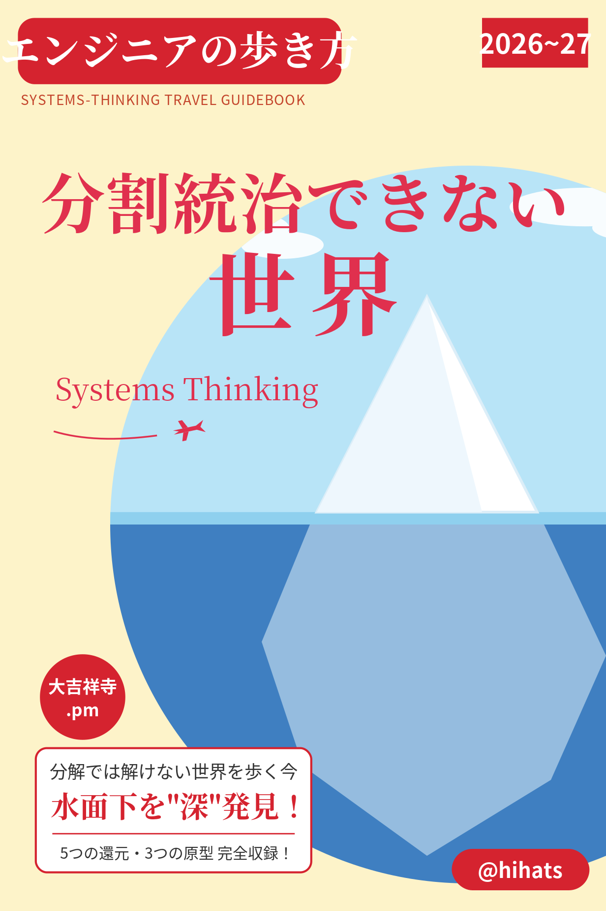
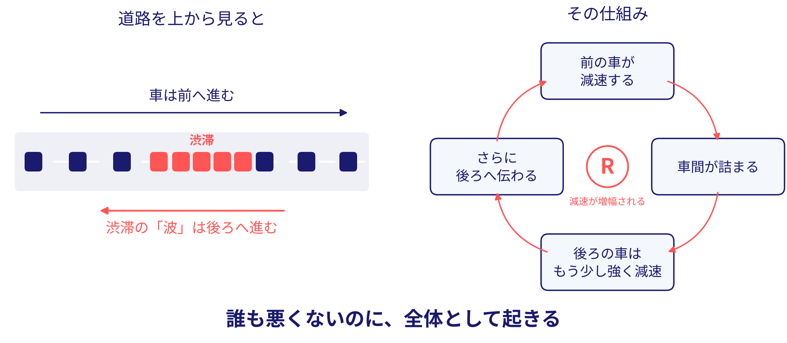
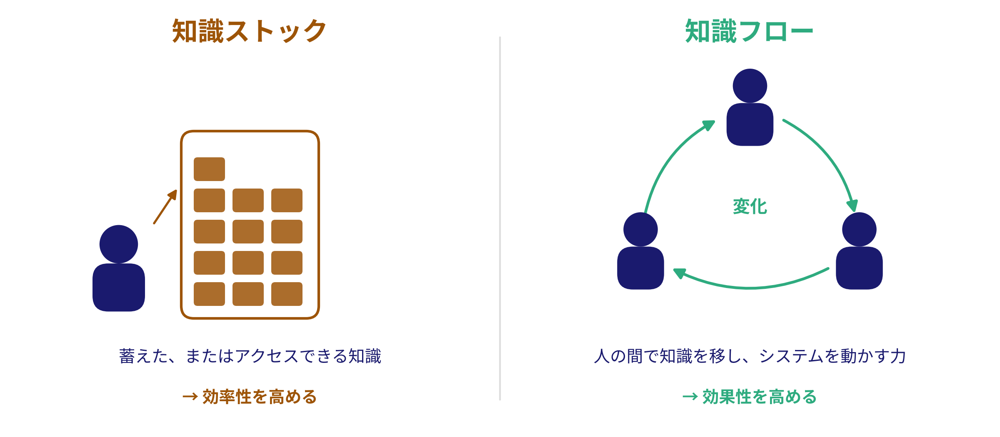

<!--
[メッセージの骨格（writing-guide手順1）]
1. カンファレンスの生態系は変わり、場は「興行と客」に近づいている（きっかけ: Jxck「cfp-over-conference」）。元々、コミュニティの存在意義は知識創出だったはず。それを見失っていないか（問い1）
2. 私たちは、なぜ仕事の外でまで学ぼうとするのか（問い2）。ソフトウェア開発に「世界を理解することで、価値を提供できる」という夢を見ているから
3. 物足りなさが残るなら、その衝動のぶつけ方がずれているのかもしれない（ベクトルのずれ。ずれを生むのは個人だけでなく場の構造でもある）。スライドとしては後半、「共有で終わる場」のループ図の直前で問いかける
4. 組織の期待に応えるよう訓練されるだけでは、その殻（局所最適の罠）は破れない。異なる環境で得た知識の持ち寄りが創発を生み、枠の外へ出る
5. コミュニティは衝動のぶつけ先であり、知識創出の事例には事欠かない。DevOpsDaysとEvent Stormingには共通の構造条件がある
6. 体験に勝る説明はない。ミニワークで創発の最小単位をその場で起こす。ただし場はタダでは維持できない
7. ぶつけ合った知識が広がって、カンファレンスという形で現れる。明日から、衝動をぶつける側として場に関わる
[起承転結] 起=§1（2つの問い） / 承=§2〜§3（殻と、その破り方） / 転=§4〜§5（聞く側からぶつける側へ） / 結=§6（カンファレンスは現れの一例）
[想定する聴衆] 最近のカンファレンスしか知らず、少しがっかりしている人。コミュニティの「創出」の側面を知ってもらう
-->

<!-- _class: nolead -->
# コミュニティは知識を創出する場である

<!-- _paginate: false -->

<!--
旧表紙は images/talk_cover.png に残してある
[00:00] スクラム祭りの趣旨（少人数の良質なコミュニティ）に直結するテーマであることを一言添えて開始
-->

## 自己紹介

- name: @hihats （塚本 久博）
- job: ソフトウェアエンジニア（IC）、過去は開発責任者・EM・技術顧問など
- address: #yokohamanorth
- スクラム祭り: 初参加
- others: Certified ScrumMaster®
<!--
TODO(hihats): スクラム祭り・地域コミュニティとの個人的な接点があれば1行足す（例: どのコミュニティ育ちか）
 大学の講義で90分
マーク・アンドリーセンについて聞いて、聴衆の解像度
-->

## 今日の主張（結論から）

> コミュニティの存在意義は、「居場所づくり」や「情報共有」ではなく「*知識創出*」にある

今日話したいことは、突き詰めればこの一文だけです

<!--
[00-02] 一文で済むことを45分喋る。「共有」と「創出」の違いはこのあと全部説明するので、いまはピンとこなくてOKと言っておく
この話をする背景なども含めてこのあとで
-->

## インデックス

<!-- _class: minor -->

| | セクション |
|---|---|
| §0 | カンファレンスの変容について |
| §2 | 骨格 — 創発が「局所最適の罠」を破る |
| §3 | 実例と構造 — DevOpsDays / Event Storming |
| §4 | ミニワーク「持ち寄りの交換」 |
| §5 | 気づきの共有と、自組織での実践 |
| §6 | ぶつけ合った知識が、カンファレンスとして現れる |

# カンファレンスの変容について

<!-- _class: caption -->
<!--
ちょっと前置きとして触れておく
-->

## カンファレンスの生態系は変わった

<!-- _class: minor -->

- 体感：主体は*コミュニティから企業へ*移ってきている

- 実際：500人以上の**企業主催はコロナ以降に急増**。ただし、コミュニティ主催も増えている

出典: 各カンファレンスの公式サイト・connpass 等から集計（2026年10月21時点、106件） {.source}

<!--
大規模なもののほうが目立つ

数え方: 参加者・申込者・定員・会場の収容人数のいずれかで500人以上を確認できたもの。2026年は開催予定を含む
読み上げる数字: 企業主催は2020年の9件 → 2026年の24件。コミュニティ主催も2020年の10件 → 2026年の19件
データ: Claude outputs/conference_list_2006-2026.csv（名称・運営母体・根拠の種類・基準ごとに数えた年）

TODO(hihats): ここで言えること →
-->

## 規模が大きくなるほど、企業抜きでは成り立たなくなる

<!-- 100人以上の規模のカンファレンスを主催するとなると、公共施設や企業のスペースでは収容しきれず、借りる会場費用が線形でなく等比級数的にかかるようになり、企業のスポンサー無しでは成り立たないということ -->
- 借りる会場の費用は人数に比例せず、**等比級数的に跳ね上がっていく**

出典: 会場費: 港区・渋谷区の公共施設、AP秋葉原・ベルサールの料金から算出（平日1日・税込） {.source}

<!--
会場費グラフ（images/venue_cost_by_size.png）の根拠。東京都心・平日1日・税込、設営・音響・配信・飲食は含まない
- 25人: 港区赤坂区民センター 第二会議室（24名）2,900円（午前800+午後1,000+夜間1,100） https://www.city.minato.tokyo.jp/akasakakanri/20131126.html
- 50人: 同 第一会議室（72名）7,500円
- 100人: 同 多目的室（90名）10,400円
- 200人: AP秋葉原 A+B+C（シアター220席）8時間 309,600円（税別）→ 約34万円 https://www.tc-forum.co.jp/ap-akihabara/pdf/013_AP_Akihabara_RevisedPrice20240101.pdf
- 400人: ベルサール渋谷ガーデン B1 HALL A（シアター420席）1時間目安93,500円×8時間 → 約75万円（会議室.COM掲載の目安。公式PDFは取得できず） https://www.kaigishitu.com/detail/43157/
- 800人: 同 B1 HALL A+B（シアター1080席）1時間目安204,417円×8時間 → 約164万円（800席前後の部屋がなく1080席で代用）
- 前提: 100人以下は企業スペース（0円）や公共施設で開ける。100人を超えると公共施設の抽選が通りにくく、実質イベントホールが選択肢になる
- 参考: 公共の大ホールは安い（渋谷区さくらホール735席 全日305,000円）が、数が少なく抽選・営利販売不可・単一ホール中心で、カンファレンスの形に合わせにくい
- 参考: 高級会場なら 虎ノ門ヒルズフォーラム ホールA（792席）9時間 2,200,000円（税別）
-->
## カンファレンス生態系の変化と CFP の功罪
<!-- _class: minor -->

> そして、規模が大きくなるほど、場は「コミュニティのメンバーが集まる場」から「**興行と、チケットを買った客**」の構図に近づきやすい
<!-- 出典に触れる、こういった記事があったことを覚えている人もいるのでは
以前は、まず勉強会があり、そこで同じテーマについて話し、徐々にコミュニティが育っていったという記事
Jxckさんに記事には、コミュニティからカンファレンスにという流れが過去は常道だった、その生態系が変わってバランスが崩れたという憂いがある
 -->
* これは構造上、必然といえる
<!--
スポンサーがつくこと、つきやすくなったことは、それ自体が価値がディスカバリーされたと言える
企業主体のカンファレンスや協賛企業を否定する話にはしない。場の性質が変わった、という事実として
大規模カンファレンスだからこそできることもある → 豪華ゲストを海外から呼んだり
RubyKaigiの例
規模が大きくなる（100人の壁を越える）ほどこのモデルに近づく、というのは、ごく自然な経済的成り行きとも言える

自分もIT勉強会カレンダーが勃興した頃に勉強会に参加し始めた人間で、大いに頷くところはある。けど何か大きな見落としがある気がした
自分がコミュニティを元々どう捉えていたか
-->

出典: [Jxck, blog.jxck.io](https://blog.jxck.io/entries/2026-07-31/cfp-over-conference.html)／[@t_wada（2026-08-02）](https://x.com/t_wada/status/2083843723507778025) {.source}

## コミュニティについて自分がどう考えていたか
<!-- _class: minor -->

元々はこうだったが、2026年のいまもまだ主張できるか、改めて問い直す価値がある

出典: [@hihats（2026-08-04）](https://x.com/hihats/status/2084572627000299928) {.source}

## コミュニティの存在意義ってそもそもなんだっけ？

## 私たちは、なぜ仕事の外でまで学ぼうとするのか

- 勉強会に通い、カンファレンスに足を運ぶ。誰かに命じられてはいない
  * 命令で来てる人いたらすみませんm(_ _)m

* 「仕事だけでは実現できない何かがある」という実感があるのではないか
<!--
[04-05] 問い2。「夢を見ている（ないし欲求に従っている）」は一人称で語る
答えの前半は§2（組織の期待に応えるよう訓練されるだけでは、その殻は破れない）、後半は「コミュニティはその衝動のぶつけ先」
TODO(hihats): この夢・衝動を自覚した場面を一言
-->

## かつてのコミュニティ勉強会に通う理由をみてみる

- 「技術の進歩に、独学や業務だけでは追いつけない」
- 「自分が『何を知らないか』を知れる」
- 「会社の上下関係を離れた、同じ関心を持つ仲間がいる」
- 「腕試しがしたい、身につけたことは会社の外の人にも認められるか」

やはり会社の中では手に入らないものを取りに行くことだった、と言える

出典: [窓の杜（2013）](https://forest.watch.impress.co.jp/docs/special/20130426_597550.html)、[@IT（2014）](https://atmarkit.itmedia.co.jp/ait/articles/1411/25/news042.html)、[横山哲也（2015）](https://blogs.itmedia.co.jp/yokoyamat/2015/02/post_37.html) {.source}

<!--
2008〜2015年の勉強会ブームのころの記事から、当時の参加者・運営者が語った動機をまとめたもの
- 独学や業務では追いつけない／自分の知らなさを知る: 窓の杜「IT 勉強会スタンプラリー」で行く、全国コミュニティ探訪 第6回（2013） https://forest.watch.impress.co.jp/docs/special/20130426_597550.html
- 業務中は新技術を試しにくい／人から直接聞くと早い／恩送り: 横山哲也「コミュニティの『恩返し』と『恩送り』」（2015、初出2012） https://blogs.itmedia.co.jp/yokoyamat/2015/02/post_37.html
- フラットな仲間／皆でハックする一体感／腕試し: @IT「JAZUG／html5j設立者たちが語るコミュニティ参加のおいしい話」（2014） https://atmarkit.itmedia.co.jp/ait/articles/1411/25/news042.html
- 腕試し: @IT（2014）の橋本氏の発言「腕試ししてみたい！」「より多くの人に認められたい！」
- 口頭で拾う（スライドからは外した）: 当時は質問し、懇親会に出て、ブログで感想を返すなど、受け取るだけでなく「返す」のが流儀だった。gihyo.jp「今こそ！勉強会」第1回（2008） https://gihyo.jp/lifestyle/feature/01/study-meeting/0001 。動機ではなく場の作法なので4項目からは外した
前のスライドの「仕事だけでは実現できない何かがある」を、当時の人たちの言葉で裏付ける位置づけ。口頭で添える「返す」の流儀は、後の「物足りなさ」「ぶつけ方」のスライドへの伏線
TODO(hihats): 自分がかつて勉強会に通っていた理由を一言（当てはまる行を指しながら）
-->

## ちょっと閑話休題
## 私の話

ここ数年、*システム思考*を学んでいる

ソフトウェアエンジニアとして身につけてきた「分割統治」だけでは、目の前の複雑な課題は解けない。それを学んできた数年だった

大吉祥寺.pmでの登壇: [分割統治できない世界の歩き方](https://slides.hihats.pro/beyond_divide_and_conquer)

* 根っこにあるのは、ソフトウェアをつくる仕事に見ている「**世界を理解することで、価値を提供できる**」という夢だと思う

<!--
TODO(hihats): システム思考に傾倒したきっかけを一言（いつ・何に詰まって）
前回の登壇は「分割統治（還元主義）で育ったエンジニアが、分解では解けない領域とどう向き合うか」の話。今日はその続きとして、システム思考の側から「コミュニティ」を見る、と位置づける
-->

## システム思考

## システム思考について
<!-- _class: minor -->

**要素そのものではなく、要素間の相互作用から、全体の振る舞いを理解する**考え方

## システム思考について
<!-- _class: minor -->

- この「カンファレンスの変容」は、システム思考で説明できる（あとで触れる）
- まずは、システム思考にある「*学習のシステム*」がコミュニティや勉強会とどう関係するか、という話をしていきたい

<!--
説明は前回デッキ「システム思考とは」の言い回しを流用。前回を見ていない人向けに粗方の説明だけ置く
口頭で話すテキスト（スライドから外したもの）
- 分解して部分を調べる「分析」の対になる見方。関係・フィードバック・遅延に注目する
- 道具は因果ループ図、ストックとフロー、氷山モデルなど
- 身近な例は自然渋滞。全員がまともに運転していても、車間と速度の相互作用だけで渋滞は起きる。誰も悪くないのに、全体として起きる現象を扱う
図の説明（images/traffic_jam_system.png）
- 左「道路を上から見ると」: 車列の一部が詰まって渋滞になっている。車は前へ進むのに、渋滞の「波」は後ろへ進む
- 右「その仕組み」: 前の車が減速する → 車間が詰まる → 後ろの車はもう少し強く減速 → さらに後ろへ伝わる、と回る自己強化ループ（R: 減速が増幅される）
- 下「誰も悪くないのに、全体として起きる」: 要素（一台一台の運転）ではなく、要素間の相互作用（車間と速度）から全体の振る舞いが生まれる、という冒頭の定義に戻る
最後の一文が「学習のシステム」への繋ぎ
カンファレンスの変化（規模→会場費→スポンサー依存→興行化）は、後半の「共有で終わる場」のループ図あたりで回収する想定
-->

## 学習のシステムについて
<!-- _class: minor -->

教育でも仕事でも、私たちは*外からの期待に応える*よう訓練されてきた。本来の好奇心や知識への欲求は、勤務時間外の「趣味」で満たすしかない

> システム思考の根底には、「学びたい」という強い衝動があるのだ
> — Diana Montalion『システム思考の世界へ』6章

* 勉強会やコミュニティは、この「期待に応える」学びの外側で、*衝動のままに学べる場所*だったのではないか

出典: Diana Montalion『システム思考の世界へ』（O'Reilly Japan）6章「学習のシステム」 {.source}

<!--
6章「学習のシステム」6.1 学習駆動キャリア（p.113）の要旨
- 教育システムは外からの期待に応えるよう訓練し、キャリアでも組織の期待に応えることが前提になる。本来の興味・好奇心・知識への欲求は勤務時間外の趣味として扱うしかない
- 学びを「期待に応えること」と捉える習慣を断ち切るのは難しい
- システム思考は内面的な動機、つまり「周囲の世界を理解し、知識を提供したい」という欲求から生まれる。根底には「学びたい」という強い衝動がある
→ 背骨の「組織の期待に応えるよう訓練されるだけでは殻は破れない」「コミュニティは衝動のぶつけ先」の出典になる。「学びたいという強い衝動」は、後半の「物足りなさ」のスライドで再び使う
最後の一文が「学習のシステム」とコミュニティ・勉強会の関係の頭出し。12p「会社の中では手に入らないものを取りに行く」を6章の言葉で言い直す位置づけ。知識ストック／フローは次のスライドで定義の触りだけ見せ、「学びとはフローの能力を高めること」は後半（「共有で終わる場」のループ図）で種明かしする

この先で使えそうな6章の論点（未使用）
- 知識ストックと知識フロー（p.111-112、定義の触りは次のスライドで使用済み）: 技術文化はストック（個人が蓄えた知識）を重視しがちだが、学びとは知識フロー（人の間で知識を移し、システムを動かす力）を高めること。コミュニティ＝フローの場、という整理に使える
- 学びを設計する4つの活動（6.3）: 成果物を作る／観察して問いを立てる／知識を統合する／経験する。それぞれ「フローを増やす例」としてイベントストーミング、ペアプロ、ワークショップで教える、が挙がっている（§3・§4と接続できる）
- 実践1「あなたを突き動かすものは何か？」（6.2）: §1の問い2「なぜ仕事の外でまで学ぶのか」と同じ問い
TODO(hihats): 引用は本文 p.113 の一文。表記を書籍と突き合わせる
-->

## 知識ストックと知識フロー
<!-- _class: minor -->

出典: Diana Montalion『システム思考の世界へ』（O'Reilly Japan）6章 p.111-112 {.source}

<!--
6章の「知識ストック」と「知識フロー」の定義を、こういう見方があるという触りだけ紹介する（図は本の図ではなく、本文の定義を図にしたもの）
- 知識ストック: これまでに蓄積した、またはアクセス可能な知識の貯蔵。効率性を向上させる（例: 「10x エンジニア」）
- 知識フロー: 知識を人々の間で（または人々と技術の間で）移転し、システムを変化させたり、動かしたりする能力。効果性を高める
ここでは定義だけにとどめ、「学びとは知識フローの能力を高めること」（p.112）や「技術文化はストックを重視しがち」は言わない。後半の「物足りなさ」と「共有で終わる場」のループ図で種明かしする
-->

## あらためてコミュニティの存在意義について
> カンファレンスの価値は、セッションそのものではなく、そういった壇上を降りたところにもあったように思う
> — Jxck

- 元々、コミュニティの存在意義は**知識を生み出すこと**だったはず。受け取る場が大きくなるほど、その意義は見えにくくなる

<!--
[03-04] 問い1。誰かが見失わせた、という話にしない。場の形が変わって見えにくくなった、という語り口
最近のカンファレンスしか知らず、少しがっかりしている人に「もう一つの側面がある」と口頭で添える
答えは§3の事例（知識創出の事例には事欠かない）と§6で回収する
TODO(hihats): 「元々は知識創出の場だった」と実感した原体験を一言（どのコミュニティで、何が生まれたか）
-->

* 私がそう考えていたのには、実際の事例も見ていたこともあったので、これから紹介していく

# §2 骨格 — 創発が「局所最適の罠」を破る

## 局所最適の罠

会社という環境で、組織の期待に応えるよう正しい判断を積み重ねる。それでも気づけば、自分たちの枠の中でしか解を探せなくなっている

- 能力の問題ではない。同じ環境にいる限り、**同じ制約と同じメンタルモデル**の中で考え続けることになるという構造の問題
- 前回の登壇で「部分最適・サブシステム分離」として扱った話の、コミュニティ版

<!--
TODO(画像): images/local_optimum.png — 局所最適の谷にはまった探索のイメージ図
[07-08] §1の問い2への答えの前半。組織の期待に応えるよう訓練されるだけでは、この殻は破れない
-->

## 創発（Emergence）とは

> 要素同士の相互作用から、**どの要素も単独では持っていなかった性質**が全体に現れること

身近な例は鳥の群れ。一羽一羽は単純なルールで飛んでいるだけなのに、群れ全体としては誰も設計していない形が生まれる

<!--
[08-10] 前回の自然渋滞（誰も悪くないのに渋滞する＝悪い創発）を覚えている人向けに、「今日はその逆、良い創発を設計する話」と接続できる
-->

## 持ち寄りが創発を起こし、創発が創出を支える

異なる環境で得た知識を持ち寄ると、誰の頭の中にもなかった視点や解決策がその場に生まれる

| | 一人で考える | 持ち寄って混ぜる |
|---|---|---|
| 使える知識 | 自分の環境で得たもののみ | 環境の数だけ |
| 制約・前提 | 自分の環境のものに固定 | 相手の前提が自分の前提を照らす |
| 出てくる解 | 局所最適の枠の内側 | **枠の外**に出ることがある |

<!--
[10-12] §2の核。「枠の外に出ることがある」— 保証はされない。だから次の§3で「起きやすくする構造」を扱う
TODO(画像): images/emergence_mix.png — 持ち寄り→混合→創発の概念図（右配置にするなら本文を箇条書きに圧縮）
-->

# §3 実例と構造 — 創発を「設計」している場

## 創発は偶然に任せなくていい

知識が生まれる場には、何度も再現されてきた実例がある

今日はコミュニティの文脈から2つを分解する

- **DevOpsDays** — 創発を起こす*場の設計*（Open Space Technology）
- **Event Storming** — コミュニティから*生まれた知識*そのもの

<!--
[12-13] セクション導入。「懇親会の盛り上がり」との違いは、創発が構造に組み込まれているかどうか
2つの実例は役割が違う: DevOpsDays は「どう起こすか（場）」、Event Storming は「何が生まれたか（成果）」
-->

## 実例1: DevOpsDays の Open Space

午後の時間は講演ではなく、**参加者がその場でテーマを立てて**少人数で議論する

- アジェンダは主催者ではなく参加者が作る（発案者がいるだけで成立）
- 「二本足の法則」— 学べも貢献もできていないなら、歩いて別の輪へ移ってよい
- 肩書もチームも違う人が、同じ問いのまわりに集まる
- 議論の結論より、**その場で出た問い**が持ち帰られる

<!--
TODO(画像): images/open_space.png — Open Spaceのマーケットプレイス（付箋のセッション表）写真か図
TODO(hihats): 実際にDevOpsDaysのOpen Spaceで体験したことを1つ口頭で（CfPの原体験ポスト参照）
[13-15]
-->

## 実例2: Event Storming

発案は Brandolini 一人。手法として育てたのは**DDDコミュニティ**

- 2013年にブログで公開。各地の実践者が自分の現場で試し、変種を「レシピ」として持ち寄った
- 原典『Introducing EventStorming』は、いまも Leanpub で書き続けられている

完成品ではなく、**持ち寄りで更新され続ける知識**

<!--
TODO(画像): images/event_storming.png — 付箋の写真より「ツアー→ブログ→各地の実践→レシピ→書籍改訂」の年表図の方が主張に合う
TODO(hihats): 事実関係を一次情報で確認する（eventstorming.com、ブログ ziobrando.blogspot.com/2013/11/introducing-event-storming.html、書籍のまえがき）。現状の根拠は Wikipedia と検索結果のみ
TODO(hihats): 自分が Event Storming を知った・試した経緯があれば一言（どのコミュニティ経由で知ったか）
[15-18] 手法の中身（付箋でドメインイベントを並べる）は一言で済ませ、経緯に時間を使う
口頭で補足: 名前が決まったのは Vaughn Vernon の DDD トレーニングツアーで登壇する直前（当初は Event-based modelling）
-->

## 知識創出の事例には事欠かない

| 年 | 場の形 | 生まれた知識 |
|---|---|---|
| 1995 | メーリングリストでのパッチの持ち寄り | Apache HTTP Server |
| 2001 | 17人の合宿（Snowbird） | アジャイルソフトウェア開発宣言 |
| 2010 | ScrumPLoP | 『A Scrum Book』のパターン群 |
| 2011 | アーキテクトのワークショップ | 「マイクロサービス」という名前 |

場の形はバラバラ。どれも小さく、どれも**知識を生んだ**

<!--
[18-19] 問い1への答え。DevOpsDaysとEvent Stormingだけではない、と示す1枚。1行ずつ読み上げすぎず、「場の形が毎回違う」点を強調する
TODO(hihats): 一次情報で確認する
  - Apache: apache.org の年表・ABOUT_APACHE（1995年2月に8人でApache Group、メーリングリストでパッチ交換）
  - アジャイル宣言: agilemanifesto.org/history（2001年2月11〜13日、17人）
  - ScrumPLoP: 公式サイト未確認（根拠はSutherlandのブログと二次情報。初回は2010年スウェーデン、書籍は2019年）
  - マイクロサービス: martinfowler.com の Microservices 記事未確認（2011年5月ヴェネツィア近郊のワークショップ、命名は2012年説あり）
-->

## 2つの実例に共通する構造条件

| 条件 | Open Space | DDDコミュニティ（Event Storming） |
|---|---|---|
| 異なる環境からの持ち寄り | 会社も役割も違う参加者 | 各社の現場で試した実践者 |
| 持ち寄りを混ぜる共同モデリング | その場で立てた問いを囲む | 実践報告がレシピとして手法に取り込まれる |
| 本音を出せる少人数の信頼関係 | 歩いて選んだ小さな輪 | ワークショップという小さな単位で試す |

場の側からも、生まれた知識の側からも、**同じ構造条件**が見える

<!--
[19-20] 3条件はこの表が初出。以降のワーク・実践パートでこの3条件を物差しとして使い回す
TODO(hihats): Event Storming 列の「信頼関係」は根拠が弱い。実感と合わなければ自分の言葉に差し替える
-->

## ワインバーグによる、問題の3つの型
<!-- _class: minor -->

ワインバーグは一般システム思考の「要訣」として、問題は次のどれかに当てはまると言う

> ① 思考のプロセスを改善したい
> ② 特定のシステムをもっと研究したい
> ③ 新しい法則をつくるか、古い法則の整備かをしたい

* 勉強会やコミュニティに通う理由も、だいたいこのどれかに当てはまる
* そして③は、一人ではなかなか起きない

出典: G.M. ワインバーグ『一般システム思考入門』（紀伊國屋書店） {.source}

<!--
ワインバーグが一般システム思考の「要訣」として挙げた三つの問題の型
- ①は「学び方を学ぶ」こと。前半の「学習のシステム」の話と対応する
- ②は特定の技術・ドメインのコミュニティ（言語やフレームワークの勉強会）に近い
- ③が今日の主張の「創出」。他人の知識とぶつかって初めて前提が書き換わる。「物足りなさ」の問いを挟んで「共有で終わる場」のループ図（カンファレンスの変容もここで説明する）につなぐ
TODO(hihats): 引用の文言とページを書籍（または引用元の解説文）と突き合わせる。いただいた解説文の出典も確認して、必要なら出典行に足す
TODO(hihats): 自分が勉強会に通っていたのはどれだったか、一言
-->

## カンファレンスに「物足りなさ」があるとしたら？
- それは「学びたい」という強い衝動から来ていませんか
- もしコミュニティやカンファレンスに何かを期待して参加して、物足りなさが残ったなら、それは学びたいという衝動の*ぶつけ方*がずれていたのかもしれない{.text-lg}

* そのずれは、自分のせいというより、*場の構造*から生まれているのかもしれない

<!--
ベクトルのずれ。聴衆を責めない。「自分もそうだった」と一人称で語る
序盤（§1）から後半のこの位置に移した。物足りなさを個人の問題ではなく、システムの構造の一部として問いかけるため
ずれを生むのは個人だけでなく、場の構造でもある（チケットを買えば「お客様」として振る舞う、壇上と客席に分かれた場では聞くことしか求められない。振る舞いは構造から生まれる）。次のループ図で「物足りなさ」を変数として描いて回収する
§1の「興行と、チケットを買った客」の構図の回収も兼ねる
TODO(hihats): ぶつけ方がずれていた自分の体験を一言（期待して行ったのに物足りなかった日、何が足りなかったか）
-->

## システム思考で見る「共有で終わる場」

「いい話を聞いた」→ 満足 → 日常に戻る → 同じ制約の中で考える → 変わらない → また話を聞きに行く

インプットを増やしても、このループは回り続ける。足りないのはインプットではなく、**自分の前提に触れてくるフィードバック**

<!--
TODO(画像): images/cld_sharing_loop.png — 「共有で終わる場」の因果ループ図（B/Rラベル付き）。前回デッキのCLD画風に合わせる。§1の回収として「受け取る姿勢（お客様化）」を変数に含め、構造が参加者のベクトルを固定していることを見せる。直前のスライドの「物足りなさ」も変数に含め、「変わらない → 物足りなさ → もっとインプットを → また話を聞きに行く」とループを回す要因として描く
[20-22]
-->

## 創発はこのループを外から破る

持ち寄られた他人の知識は、自分の環境の外から来る。だから自分の前提を照らせる

3つの構造条件は、この「外からのフィードバック」を意図的に発生させる装置と読める

* 衝動をぶつける先は、壇上ではなく**隣にいる人の知識**

<!--
TODO(画像): images/cld_emergence_break.png — 上のCLDに「持ち寄り→創発」の矢印が外から入ってループを破る図
[22-23] ここまでが理論。「では体験してもらいます」で§4へ
-->

# §4 ミニワーク「持ち寄りの交換」

## やること（10分）

1. 近くの席の人とペアになる（できれば**初対面の人、違う会社の人**と）
2. 直近1ヶ月で、自分の環境（チーム・会社・家庭）から得た学びを1つ思い出す（1分）
3. お互いに話す（3分 × 2人分）
4. 次のスライドの問いに、答えを一言で書き出す（2分）

オンライン参加のみなさんは、同じ問いへの答えをチャットへどうぞ

<!--
[23-25] インストラクション。「学び」は仕事に限らなくていいと添える（環境が違うほど創発が起きやすい）
TODO(hihats): オンライン回答の収集手段を運営と確認（Zoomチャット or 別ツール）。Requirementsにはブラウザ利用希望と記載済み
-->

## 問い

「相手の知識を自分の環境に当てはめると、何が変わるか」{.text-xl2 .blue}

一言でOK。「変わらない」ならなぜ変わらないかを一言で

<!--
[25-33] ワーク中はこのスライドを出しっぱなしにする。残り時間を口頭でカウント
-->

# §5 気づきの共有と、自組織での実践

## いま起きたことを、3つの条件に当てはめる

| 条件 | いまのワークでは |
|---|---|
| 異なる環境からの持ち寄り | 隣の人は違う会社・違うチーム・違う家庭 |
| 持ち寄りを混ぜる共同モデリング | 「自分の環境に当てはめると」という問い |
| 本音を出せる少人数の信頼関係 | たった2人。逃げ場のない近さ |

たった10分・たった2人でも、構造が揃えば創発の芽は出る。**人数でも予算でもなく、構造の問題**

<!--
[33-35] 会場とチャットから「変わりそうなこと」を2〜3拾って読み上げてから、この種明かしに入る
-->

## 自組織に持ち込む

<!--
TODO(hihats): ここは本人のエピソードで差し替える前提の骨組み。CfPでは例示として
「Agenticコーディングツール全員導入の効果分析を『持ち寄りと共同の知識創出』として回した経験」
「開発組織の強みの共同定義」「クロスファンクショナルな対話の場の設計」を挙げている。
当日もっとも学びの大きいエピソードを1〜2に絞り、3条件との対応を語る。
スライドは選んだエピソードに合わせて1〜2枚で構成し直す（このスライドはプレースホルダ）
-->

- どのエピソードを話すか（1〜2個に絞る）
- そのとき3つの構造条件はどう揃っていたか / どれが欠けて何が起きたか

## ただし、場はタダでは維持できない

> コミュニティの形成とは、実は驚くほど地味でタイパの悪いものだ — Jxck

その運営の多くは**運営者の善意**で支えられている。だから全部を自前で立ち上げなくていい

::::c
:::_
- **小さく始める** — 2人のワークで芽は出た
- **既存の場に相乗りする** — 社内の定例、地域の勉強会
:::

:::_
- **生態系を使う** — 戻り始めた勉強会やLT会、そしてカンファレンス
:::
::::

<!--
[35-38] 運営コストの但し書き。記事の筆者が今年は月1の小さな勉強会に戻した話も紹介できる。過度の期待はコミュニティを痩せさせる、という話をここで
TODO(hihats): 運営コストを実感した自身の体験があれば一言（コミュニティ運営・社内の場づくりなど）
-->

# §6 まとめ

## ぶつけ合った知識は、カンファレンスとして現れる

コミュニティでぶつけ合った知識が広がると、カンファレンスという形で現れる。カンファレンスは、その一例

冒頭で見た「興行と客」の構図の内側にも、元をたどれば**誰かが衝動をぶつけ合った場**がある

<!--
[38-41] §1の2つの問いを回収する
問い1（存在意義を見失っていないか）: カンファレンスは知識創出の結果として現れたもの。受け取る側にいると、その源が見えにくい
問い2（なぜ仕事の外でまで学ぶのか）: 世界を理解したいという衝動のぶつけ先がコミュニティだから
スクラム祭りの趣旨「コミュニティ同士を繋げ、新たな知見をつむぎ出す」との接続をここで明言
-->

## 可能性のリミッターを取り外す鍵

リミッターの正体は、同じ制約と同じメンタルモデルの中で考え続けてしまう、自分の環境という枠

鍵は意志の力ではなく、**異なる環境の知識が持ち寄られ、混ざる場**に身を置くこと。その場は設計できる

## 明日からの一歩

次にカンファレンスや勉強会へ行くときは、聞くためではなく**持ち寄るために**

- 今日のワークの相手と、もう一度どこかで話す（持ち寄りの継続が一番安い一歩）
- 自分が既にいる場（定例・振り返り・勉強会）に、3つの構造条件のうち欠けているものを1つ足す

<!--
[41-44] 新しい情報は足さない。行動は2つに絞る
-->

## 参考文献

<!-- _class: minor -->

- 野中郁次郎, 竹内弘高『知識創造企業』東洋経済新報社 — 知識の共有と創出の区別の源流（SECIモデル）
- Harrison Owen, *Open Space Technology: A User's Guide* — Open Spaceの原典
- Alberto Brandolini, *Introducing EventStorming* — Event Stormingの原典
- Diana Montalion『システム思考の世界へ』O'Reilly Japan — 共同モデリング（10.1.1）
- ドネラ・H・メドウズ『世界はシステムで動く』英治出版 — フィードバックループ
- G.M. ワインバーグ『一般システム思考入門』紀伊國屋書店 — 一般システム思考の「要訣」（問題の3つの型）
- [Jxck, blog.jxck.io (2026-07-31)](https://blog.jxck.io/entries/2026-07-31/cfp-over-conference.html) — カンファレンスとコミュニティの変化

## ご清聴ありがとうございました

Q&A

<!--
[44-45] 質問が出ない場合に備えて: 「社内コミュニティで3条件のうち一番作りにくいのは？」を自問自答で用意
-->
