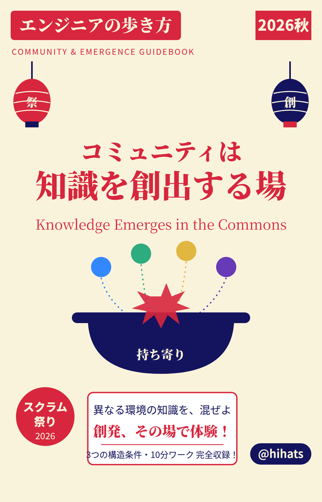
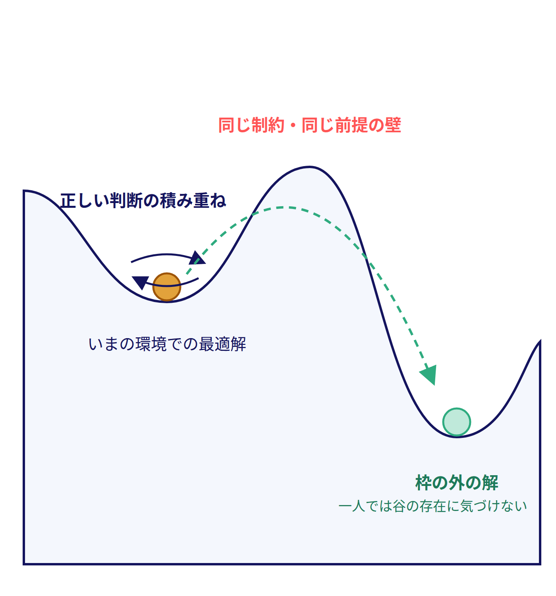
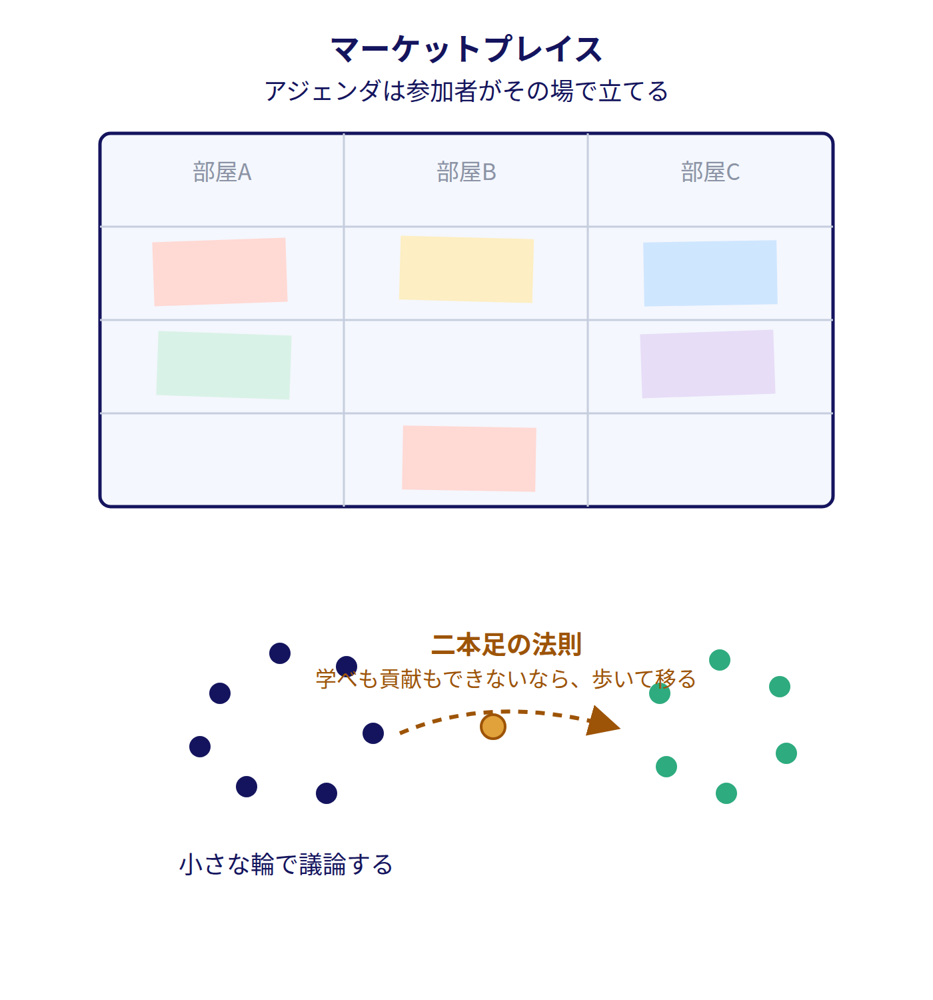
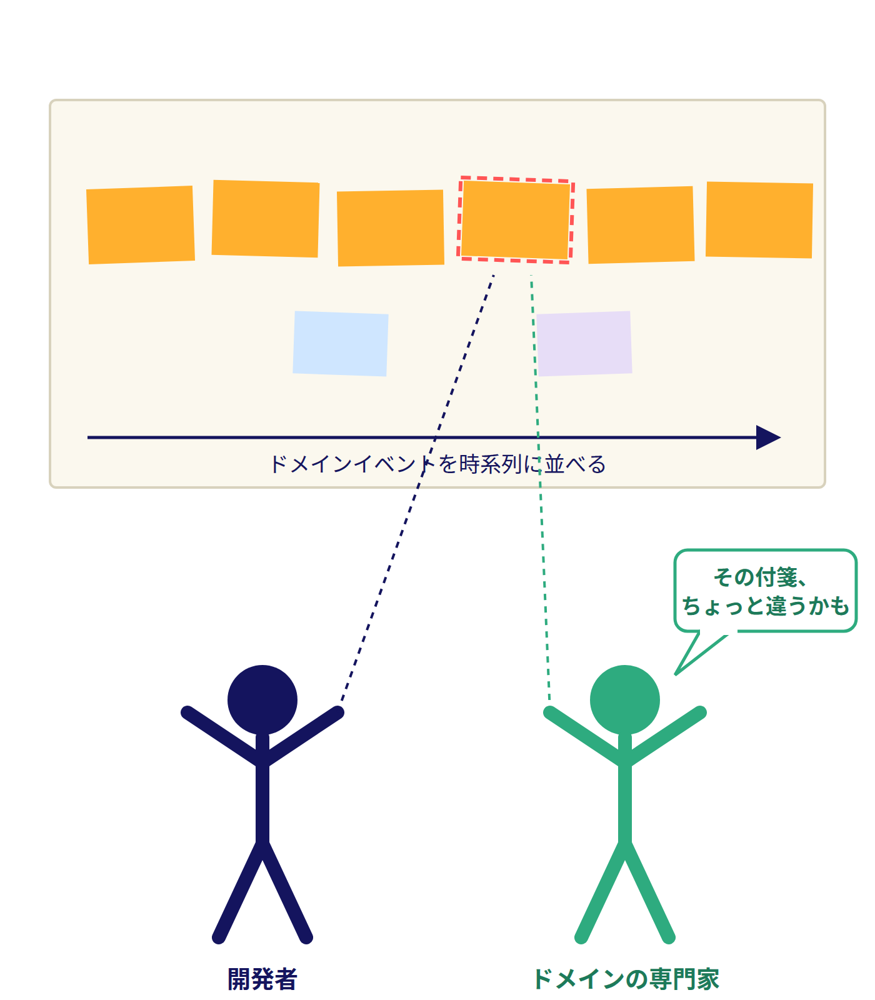
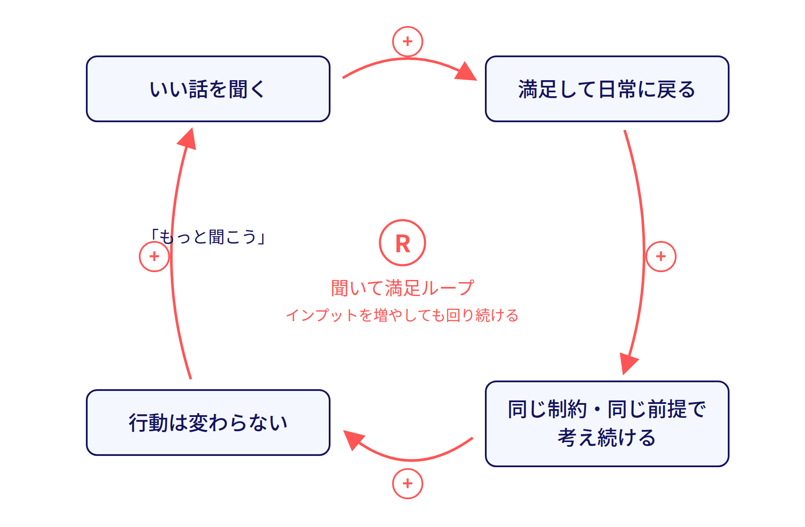
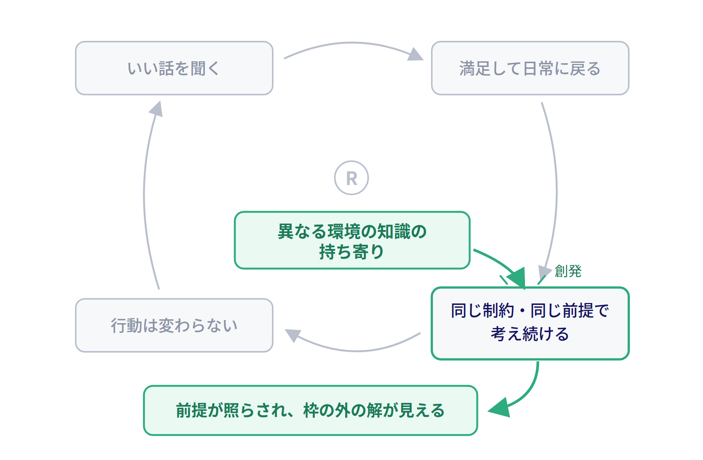

<!--
[メッセージの骨格（writing-guide手順1）]
1. カンファレンスやコミュニティの形は変わり、困難に直面している（きっかけ: Jxck「cfp-over-conference」）。それでも、学びの手段として必要とされることは変わらない
2. 必要とされ続ける理由は、コミュニティの存在意義が知識の「共有」ではなく「創出」にあるから。共有だけなら録画とスライドで足りる
   物足りなさが残ったなら、それは参加する自分の知識創出へのベクトルが合っていなかったのかもしれない（問題提起）
   ただし、ベクトルが知識創出に向かないのも構造の問題かもしれない（振る舞いは構造から生まれる）
3. 同じ環境で正しい判断を積み重ねるだけでは「局所最適の罠」から抜けられない。異なる環境で得た知識の持ち寄りが創発を生み、枠の外へ出る
4. 創発は偶然ではなく設計できる。DevOpsDaysとEvent Stormingには共通の構造条件がある
5. 体験に勝る説明はない。ミニワークで創発の最小単位をその場で起こす
6. 場はタダでは維持できない。運営コストとの折り合いまで含めてシステムとして扱う
7. 歴史を見ても、場の形は変わり続けたが、知識を生む場として必要とされてきた。明日から「持ち寄る側」として場に関わる
[想定する聴衆] 最近のカンファレンスしか知らず、少しがっかりしている人。コミュニティの「創出」の側面を知ってもらう
-->

# コミュニティは知識を創出する場である

可能性のリミッターを取り外す鍵

<!-- _paginate: false -->

<!--
TODO(画像): images/talk_cover.png — 表紙ビジュアル
[00:00] スクラム祭りの趣旨（少人数の良質なコミュニティ）に直結するテーマであることを一言添えて開始
-->

## 自己紹介

- name: @hihats
- job: ソフトウェアエンジニア（IC）、過去は開発責任者・EM・技術顧問など
- Certified ScrumMaster®
- 前回の登壇:「分割統治できない世界の歩き方」（システム思考の話。今日はその続編でもある）

<!--
TODO(hihats): スクラム祭り・地域コミュニティとの個人的な接点があれば1行足す（例: どのコミュニティ育ちか）
-->

## 今日の主張（結論から）

> カンファレンスやコミュニティの形が変わっても、学びの手段として必要とされることは変わらない。
> コミュニティは、知識を「共有」ではなく「*創出*」する場だから

今日話したいことは、突き詰めればこの一文だけです

<!--
[00-02] 結論を先に宣言する。「共有」と「創出」の違いはこのあと全部説明するので、いまはピンとこなくてOKと言っておく
-->

## インデックス

| | セクション | 時間 |
|---|---|---|
| §1 | カンファレンスは変わった。でも | 00-07 |
| §2 | 骨格 — 創発が「局所最適の罠」を破る | 07-12 |
| §3 | 実例と構造 — DevOpsDays / Event Storming | 12-23 |
| §4 | ミニワーク「持ち寄りの交換」 | 23-33 |
| §5 | 気づきの共有と、自組織での実践 | 33-38 |
| §6 | 形は変わる。必要とされることは変わらない | 38-45 |

# §1 カンファレンスは変わった。でも

## カンファレンスの生態系は変わった

::::c
:::_
### コロナ前
- 勉強会から*コミュニティ*が育ち、その集大成として*カンファレンス*を開く
- 参加者は、もてなされる客ではなくコミュニティの一員
:::

:::_
### コロナ後 {.red}
- 勉強会の蓄積を持たず「初手で開催」されるカンファレンスが増えた
- 登壇は全てCFP公募、参加者は「お客様」に
:::
::::

出典: [Jxck, blog.jxck.io (2026-07-31)](https://blog.jxck.io/entries/2026-07-31/cfp-over-conference.html){.text-xs}

<!--
[02-03] 記事の要約は短く。主催・登壇者・参加者の誰かを責める話ではなく「構造が変わった」話として紹介する
TODO(hihats): 記事タイトルを正式名で記載する（現状はURLのスラッグのみ）
TODO(hihats): 記事を読んで自分が感じたことを一言（このトークを作るきっかけになった、など）
-->

## 録画とスライドで済むなら、それは「共有」の場

> カンファレンスの価値は、セッションそのものではなく、そういった壇上を降りたところにもあったように思う
> — Jxck

最近のカンファレンスしか知らず、少しがっかりしている人に知ってほしい。コミュニティには、**知識が生まれる**というもう一つの側面がある

<!--
[03-04] 記事の「録画とスライドを見ればいい、で済むカンファレンス」という一節を口頭で引く
「聞くだけ」なら録画で足りる。録画で再現できないもの＝持ち寄りから生まれるもの、が今日の主題だと宣言して次へ
-->

## 同じ集まりなのに、帰り道が違う日がある

::::c
:::_
### 共有で終わった日 {.gray}
- 「いい話を聞いた」で満足して帰る
- 翌週には内容を思い出せない
:::

:::_
### 何かが生まれた日 {.green}
- 帰り道に設計を書き直したくなっている
- 自分の言葉で誰かに話したくなっている
:::
::::

<!--
[04-05] 聴衆への問いかけから入る。「どちらの経験もありますよね？」
TODO(hihats): 「何かが生まれた日」の実体験を1つ、口頭で話す（どの勉強会・どんな瞬間だったか）
-->

## 物足りなさは、ベクトルのずれかもしれない

もしコミュニティに何かを期待して参加して、物足りなさが残ったなら、それは参加する自分の*知識創出へのベクトル*が合っていなかったのかもしれない{.text-lg}

受け取りに行く参加は、録画でも代わりがきく。生み出しに行く参加は、**その場にいないと起きない**

<!--
[05-06] 問題提起。聴衆を責める話にしないこと。「自分もそうだった」と一人称で語る
TODO(hihats): ベクトルが合っていなかった自分の体験を一言（期待して行ったのに物足りなかった日、何が足りなかったか）
-->

## ベクトルが向かないのも、構造のせいかもしれない

参加者が知識創出に向かわないのは、意欲やスキルの問題とは限らない。場がそう振る舞わせている

- チケットを買えば、人は「お客様」として振る舞う
- 壇上と客席に分かれた場では、聞くことしか求められない

システム思考の基本は、**振る舞いは構造から生まれる**こと（メドウズ『世界はシステムで動く』）

<!--
[06-07] §1の締め。前のスライドの問題提起を、個人の責任から構造の問題へ反転させる。聴衆を責めずに済む転回
「お客様化」は記事でも、有料チケットという構造が生む振る舞いとして書かれている
「では、知識が生まれる場の構造とは何か」で§2へ。§3の因果ループ図でこの話を回収する
-->

# §2 骨格 — 創発が「局所最適の罠」を破る

## 局所最適の罠

会社という環境の中で、正しい判断を積み重ねる。それでも気づけば、自分たちの枠の中でしか解を探せなくなっている

- 能力の問題ではない。同じ環境にいる限り、**同じ制約と同じメンタルモデル**の中で考え続けることになるという構造の問題
- 前回の登壇で「部分最適・サブシステム分離」として扱った話の、コミュニティ版

<!--
TODO(画像): images/local_optimum.png — 局所最適の谷にはまった探索のイメージ図
[07-08]
-->

## 創発（Emergence）とは

> 要素同士の相互作用から、**どの要素も単独では持っていなかった性質**が全体に現れること

身近な例は鳥の群れ。一羽一羽は単純なルールで飛んでいるだけなのに、群れ全体としては誰も設計していない形が生まれる

<!--
[08-10] 前回の自然渋滞（誰も悪くないのに渋滞する＝悪い創発）を覚えている人向けに、「今日はその逆、良い創発を設計する話」と接続できる
-->

## 持ち寄りが創発を起こし、創発が創出を支える

異なる環境で得た知識を持ち寄ると、誰の頭の中にもなかった視点や解決策がその場に生まれる

| | 一人で考える | 持ち寄って混ぜる |
|---|---|---|
| 使える知識 | 自分の環境で得たもののみ | 環境の数だけ |
| 制約・前提 | 自分の環境のものに固定 | 相手の前提が自分の前提を照らす |
| 出てくる解 | 局所最適の枠の内側 | **枠の外**に出ることがある |

<!--
[10-12] §2の核。「枠の外に出ることがある」— 保証はされない。だから次の§3で「起きやすくする構造」を扱う
TODO(画像): images/emergence_mix.png — 持ち寄り→混合→創発の概念図（右配置にするなら本文を箇条書きに圧縮）
-->

# §3 実例と構造 — 創発を「設計」している場

## 創発は偶然に任せなくていい

知識が生まれる場には、何度も再現されてきた実例がある

今日はコミュニティの文脈から2つを分解する

- **DevOpsDays** — 創発を起こす*場の設計*（Open Space Technology）
- **Event Storming** — コミュニティから*生まれた知識*そのもの

<!--
[12-13] セクション導入。「懇親会の盛り上がり」との違いは、創発が構造に組み込まれているかどうか
2つの実例は役割が違う: DevOpsDays は「どう起こすか（場）」、Event Storming は「何が生まれたか（成果）」
-->

## 実例1: DevOpsDays の Open Space

午後の時間は講演ではなく、**参加者がその場でテーマを立てて**少人数で議論する

- アジェンダは主催者ではなく参加者が作る（発案者がいるだけで成立）
- 「二本足の法則」— 学べも貢献もできていないなら、歩いて別の輪へ移ってよい
- 肩書もチームも違う人が、同じ問いのまわりに集まる
- 議論の結論より、**その場で出た問い**が持ち帰られる

<!--
TODO(画像): images/open_space.png — Open Spaceのマーケットプレイス（付箋のセッション表）写真か図
TODO(hihats): 実際にDevOpsDaysのOpen Spaceで体験したことを1つ口頭で（CfPの原体験ポスト参照）
[13-15]
-->

## 実例2: Event Storming

発案は Brandolini 一人。手法として育てたのは**DDDコミュニティ**

- 2013年にブログで公開。各地の実践者が自分の現場で試し、変種を「レシピ」として持ち寄った
- 原典『Introducing EventStorming』は、いまも Leanpub で書き続けられている

完成品ではなく、**持ち寄りで更新され続ける知識**

<!--
TODO(画像): images/event_storming.png — 付箋の写真より「ツアー→ブログ→各地の実践→レシピ→書籍改訂」の年表図の方が主張に合う
TODO(hihats): 事実関係を一次情報で確認する（eventstorming.com、ブログ ziobrando.blogspot.com/2013/11/introducing-event-storming.html、書籍のまえがき）。現状の根拠は Wikipedia と検索結果のみ
TODO(hihats): 自分が Event Storming を知った・試した経緯があれば一言（どのコミュニティ経由で知ったか）
[15-18] 手法の中身（付箋でドメインイベントを並べる）は一言で済ませ、経緯に時間を使う
口頭で補足: 名前が決まったのは Vaughn Vernon の DDD トレーニングツアーで登壇する直前（当初は Event-based modelling）
-->

## 2つの実例に共通する構造条件

| 条件 | Open Space | DDDコミュニティ（Event Storming） |
|---|---|---|
| 異なる環境からの持ち寄り | 会社も役割も違う参加者 | 各社の現場で試した実践者 |
| 持ち寄りを混ぜる共同モデリング | その場で立てた問いを囲む | 実践報告がレシピとして手法に取り込まれる |
| 本音を出せる少人数の信頼関係 | 歩いて選んだ小さな輪 | ワークショップという小さな単位で試す |

場の側からも、生まれた知識の側からも、**同じ構造条件**が見える

<!--
[18-20] 3条件はこの表が初出。以降のワーク・実践パートでこの3条件を物差しとして使い回す
TODO(hihats): Event Storming 列の「信頼関係」は根拠が弱い。実感と合わなければ自分の言葉に差し替える
-->

## システム思考で見る「共有で終わる場」

「いい話を聞いた」→ 満足 → 日常に戻る → 同じ制約の中で考える → 変わらない → また話を聞きに行く

インプットを増やしても、このループは回り続ける。足りないのはインプットではなく、**自分の前提に触れてくるフィードバック**

<!--
TODO(画像): images/cld_sharing_loop.png — 「共有で終わる場」の因果ループ図（B/Rラベル付き）。前回デッキのCLD画風に合わせる。§1の回収として「受け取る姿勢（お客様化）」を変数に含め、構造が参加者のベクトルを固定していることを見せる
[20-22]
-->

## 創発はこのループを外から破る

持ち寄られた他人の知識は、自分の環境の外から来る。だから自分の前提を照らせる

3つの構造条件は、この「外からのフィードバック」を意図的に発生させる装置と読める

<!--
TODO(画像): images/cld_emergence_break.png — 上のCLDに「持ち寄り→創発」の矢印が外から入ってループを破る図
[22-23] ここまでが理論。「では体験してもらいます」で§4へ
-->

# §4 ミニワーク「持ち寄りの交換」

## やること（10分）

1. 近くの席の人とペアになる（できれば**初対面の人、違う会社の人**と）
2. 直近1ヶ月で、自分の環境（チーム・会社・家庭）から得た学びを1つ思い出す（1分）
3. お互いに話す（3分 × 2人分）
4. 次のスライドの問いに、答えを一言で書き出す（2分）

オンライン参加のみなさんは、同じ問いへの答えをチャットへどうぞ

<!--
[23-25] インストラクション。「学び」は仕事に限らなくていいと添える（環境が違うほど創発が起きやすい）
TODO(hihats): オンライン回答の収集手段を運営と確認（Zoomチャット or 別ツール）。Requirementsにはブラウザ利用希望と記載済み
-->

## 問い

「相手の知識を自分の環境に当てはめると、何が変わるか」{.text-xl2 .blue}

一言でOK。「変わらない」ならなぜ変わらないかを一言で

<!--
[25-33] ワーク中はこのスライドを出しっぱなしにする。残り時間を口頭でカウント
-->

# §5 気づきの共有と、自組織での実践

## いま起きたことを、3つの条件に当てはめる

| 条件 | いまのワークでは |
|---|---|
| 異なる環境からの持ち寄り | 隣の人は違う会社・違うチーム・違う家庭 |
| 持ち寄りを混ぜる共同モデリング | 「自分の環境に当てはめると」という問い |
| 本音を出せる少人数の信頼関係 | たった2人。逃げ場のない近さ |

たった10分・たった2人でも、構造が揃えば創発の芽は出る。**人数でも予算でもなく、構造の問題**

<!--
[33-35] 会場とチャットから「変わりそうなこと」を2〜3拾って読み上げてから、この種明かしに入る
-->

## 自組織に持ち込む

<!--
TODO(hihats): ここは本人のエピソードで差し替える前提の骨組み。CfPでは例示として
「Agenticコーディングツール全員導入の効果分析を『持ち寄りと共同の知識創出』として回した経験」
「開発組織の強みの共同定義」「クロスファンクショナルな対話の場の設計」を挙げている。
当日もっとも学びの大きいエピソードを1〜2に絞り、3条件との対応を語る。
スライドは選んだエピソードに合わせて1〜2枚で構成し直す（このスライドはプレースホルダ）
-->

- どのエピソードを話すか（1〜2個に絞る）
- そのとき3つの構造条件はどう揃っていたか / どれが欠けて何が起きたか

## ただし、場はタダでは維持できない

> コミュニティの形成とは、実は驚くほど地味でタイパの悪いものだ — Jxck

その運営の多くは**運営者の善意**で支えられている。だから全部を自前で立ち上げなくていい

::::c
:::_
- **小さく始める** — 2人のワークで芽は出た
- **既存の場に相乗りする** — 社内の定例、地域の勉強会
:::

:::_
- **生態系を使う** — 戻り始めた勉強会やLT会、そしてカンファレンス
:::
::::

<!--
[35-38] 運営コストの但し書き。記事の筆者が今年は月1の小さな勉強会に戻した話も紹介できる。過度の期待はコミュニティを痩せさせる、という話をここで
TODO(hihats): 運営コストを実感した自身の体験があれば一言（コミュニティ運営・社内の場づくりなど）
-->

# §6 まとめ

## 形は変わっても、必要とされることは変わらない

| 年 | 場の形 | 生まれた知識 |
|---|---|---|
| 1995 | メーリングリストでのパッチの持ち寄り | Apache HTTP Server |
| 2001 | 17人の合宿（Snowbird） | アジャイルソフトウェア開発宣言 |
| 2010 | ScrumPLoP | 『A Scrum Book』のパターン群 |
| 2011 | アーキテクトのワークショップ | 「マイクロサービス」という名前 |

場の形はバラバラ。どれも小さく、どれも**知識を生んだ**

<!--
[38-41] 最近のカンファレンスしか知らない人に向けた「もう一つの側面」の証拠。1行ずつ読み上げすぎず、「場の形が毎回違う」点を強調する
スクラム祭りの趣旨「コミュニティ同士を繋げ、新たな知見をつむぎ出す」との接続をここで明言
カンファレンスは本来コミュニティの集大成。いまの形のカンファレンスでも「持ち寄る場」として使えば、この側面に触れられる
TODO(hihats): 一次情報で確認する
  - Apache: apache.org の年表・ABOUT_APACHE（1995年2月に8人でApache Group、メーリングリストでパッチ交換）
  - アジャイル宣言: agilemanifesto.org/history（2001年2月11〜13日、17人）
  - ScrumPLoP: 公式サイト未確認（根拠はSutherlandのブログと二次情報。初回は2010年スウェーデン、書籍は2019年）
  - マイクロサービス: martinfowler.com の Microservices 記事未確認（2011年5月ヴェネツィア近郊のワークショップ、命名は2012年説あり）
-->

## 可能性のリミッターを取り外す鍵

リミッターの正体は、同じ制約と同じメンタルモデルの中で考え続けてしまう、自分の環境という枠

鍵は意志の力ではなく、**異なる環境の知識が持ち寄られ、混ざる場**に身を置くこと。その場は設計できる

## 明日からの一歩

次にカンファレンスや勉強会へ行くときは、聞くためではなく**持ち寄るために**

- 今日のワークの相手と、もう一度どこかで話す（持ち寄りの継続が一番安い一歩）
- 自分が既にいる場（定例・振り返り・勉強会）に、3つの構造条件のうち欠けているものを1つ足す

<!--
[41-44] 新しい情報は足さない。行動は2つに絞る
-->

## 参考文献

- 野中郁次郎, 竹内弘高『知識創造企業』東洋経済新報社 — 知識の共有と創出の区別の源流（SECIモデル）
- Harrison Owen, *Open Space Technology: A User's Guide* — Open Spaceの原典
- Alberto Brandolini, *Introducing EventStorming* — Event Stormingの原典
- Diana Montalion『システム思考の世界へ』O'Reilly Japan — 共同モデリング（10.1.1）
- ドネラ・H・メドウズ『世界はシステムで動く』英治出版 — フィードバックループ
- [Jxck, blog.jxck.io (2026-07-31)](https://blog.jxck.io/entries/2026-07-31/cfp-over-conference.html) — コロナ後のカンファレンスとコミュニティの変化

## ご清聴ありがとうございました

Q&A

<!--
[44-45] 質問が出ない場合に備えて: 「社内コミュニティで3条件のうち一番作りにくいのは？」を自問自答で用意
-->
